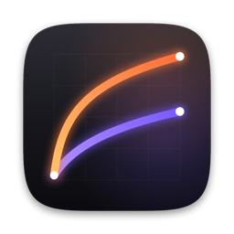

<p align="center"></p>

<h1 align="center">DlogSort</h1>

<p align="center">一眼分辨 DJI Pocket 4P 拍的视频是 <b>D-Log</b> 还是 <b>D-Log2</b>，并一键整理。</p>

<p align="center"><a href="https://chokamin.github.io/DlogSort/"><b>在线使用（Windows / Mac / 手机）</b></a> · <a href="../../releases/latest"><b>下载 Mac 版</b></a></p>

---

DJI Osmo Pocket 4P 有 D-Log 和 D-Log2 两种色彩模式，但导入电脑后文件名完全一样，没法直接区分。DlogSort 读取相机写进视频文件里的元数据，自动标出每段视频的模式。

## 功能

- **拖进来就识别**：把视频或整个文件夹拖进窗口（或拖到 Dock 图标上），子文件夹也会扫描
- **列表展示**：缩略图、时长、镜头、ISO、分辨率、帧率，以及醒目的 D-Log / D-Log2 标记
- **筛选**：全部 / D-Log / D-Log2 / 其他
- **打 Finder 标签**：给视频加上橙色 `Dlog` 或紫色 `Dlog2` 标签，文件位置不变
- **导出到达芬奇**：生成元数据 CSV，导入 DaVinci Resolve 后片段带上 `D-Log` / `D-Log2` 关键词，可自动生成智能媒体夹
- **整理到文件夹**：移到所在目录下的 `Dlog/`、`Dlog2/` 子文件夹，同名 `.LRF` 代理文件和 `.SRT` 字幕一起移动
- 双击播放，右键在 Finder 中显示，⌘O 添加文件
- 几千个视频也不卡：后台读取，底栏显示进度
- 自动更新：使用 [Sparkle](https://sparkle-project.org)，有新版本时弹出更新窗口，一键下载安装并重新打开；也可以从菜单「DlogSort → 检查更新…」手动检查

## 原理

不分析画面，而是直接读取 DJI 写入 MP4 元数据的字段：

```
com.dji.camera.ColorGammaSxS = D-Log | D-Log2
```

所以结果是确定的，不会误判。用 `ffprobe` 也能看到这个字段：

```bash
ffprobe -v error -show_entries format_tags=com.dji.camera.ColorGammaSxS -of default=nw=1 视频.MP4
```

## 在达芬奇里使用

点「导出到达芬奇」（网页版在「导出 → 达芬奇元数据」）得到 CSV，然后在 DaVinci Resolve 里：

1. 把视频导入媒体池
2. **文件 → 导入元数据至 → 媒体池**，选中 CSV
3. 勾选「用文件名称匹配」，**取消勾选**「使用片段起始和终止时间码匹配」，点确定
4. 片段会带上关键词 `D-Log` 或 `D-Log2`，在元数据面板的 **Shot & Scene** 组里查看，或在媒体池列表视图中显示「关键词」列
5. 在 **偏好设置 → 用户 → 剪辑 → 自动智能媒体夹** 勾选「关键词」，智能媒体夹里会自动出现 D-Log 和 D-Log2，方便分别套用 LUT

已在 DaVinci Resolve 21.1.2 上用 131 个 Pocket 4P 片段验证。

Mac 用户也可以试试「打 Finder 标签」，再在达芬奇 **偏好设置 → 用户 → 剪辑** 打开 *Import Finder tags as Keywords*，导入素材时自动带上标签（这个方式还没实测，推荐用上面的 CSV）。

## 网页版

打开 **https://chokamin.github.io/DlogSort/** 就能用，Windows、Mac、Linux、手机都可以。

- 视频不会上传，全部在浏览器里读取，只读文件末尾的元数据，大文件也是瞬间完成
- 显示缩略图（读取 DJI 内嵌的预览图，不需要浏览器能解码 HEVC）、镜头、ISO、分辨率、帧率
- 网页无法直接移动本地文件，「整理到文件夹」会生成脚本：Windows 下载 `.bat` 双击运行，macOS / Linux 下载 `.sh` 用 `sh` 运行。脚本要放在你拖进网页的那些文件 / 文件夹所在的目录
- 可以导出 CSV 列表

## Mac 版下载

到 [Releases](../../releases) 下载 `DlogSort.zip`，解压后拖进「应用程序」文件夹。

- 需要 macOS 14 或更新版本，Apple 芯片和 Intel Mac 都支持
- 已用 Developer ID 签名并通过 Apple 公证，双击即可打开

## 从源码构建

需要 Xcode 命令行工具（装了完整 Xcode 时，图标会编译成 macOS 26 的新格式）：

```bash
./DlogSort/build.sh
```

会在仓库根目录生成 `DlogSort.app`。钥匙串里有 Developer ID Application 证书时会自动正式签名，否则用临时签名。

### 发布新版本

1. 在 `DlogSort/build.sh` 里把 `VERSION` 改成新版本号，`BUILD` 加 1（Sparkle 靠 `BUILD` 判断新旧）
2. 编译并公证（需先用 `xcrun notarytool store-credentials DlogSort-notary` 保存一次凭据）：

   ```bash
   ./DlogSort/build.sh && ./DlogSort/notarize.sh
   ```
3. 把 `DlogSort.zip` 上传到 GitHub Release，tag 为 `v版本号`
4. 写好发布说明（HTML），更新 Sparkle 更新源后提交推送：

   ```bash
   ./DlogSort/appcast.sh 发布说明.html
   ```

更新包用钥匙串里账户名为 `DlogSort` 的 EdDSA 私钥签名，公钥写在 `build.sh` 的 `SUPublicEDKey` 里。**私钥丢了就无法给已安装的用户推送更新**，请导出备份并妥善保管（不要放进仓库）：

```bash
./Vendor/Sparkle-2.10.0/bin/generate_keys --account DlogSort -x ~/DlogSort-sparkle-key.txt
```

| 文件 | 作用 |
|---|---|
| `DlogSort/main.swift` | 应用全部代码（SwiftUI + AVFoundation） |
| `DlogSort/make_icon.swift` | 用代码绘制应用图标 |
| `DlogSort/build.sh` | 编译、生成图标、打包签名 |
| `DlogSort/notarize.sh` | 提交 Apple 公证、钉入票据、生成发布用 zip |
| `DlogSort/appcast.sh` | 签名更新包，写入 Sparkle 更新源 `docs/appcast.xml` |
| `docs/index.html` | 网页版（单文件，无依赖，通过 GitHub Pages 发布） |

## 适用范围

- 已验证：DJI Osmo Pocket 4P 的 D-Log 和 D-Log2
- 其他大疆设备如果写了同一个字段，会显示出模式，但只有 D-Log / D-Log2 会被整理
- 其他品牌（索尼 S-Log、Apple Log 等）的元数据格式不同，会显示为「未识别」
